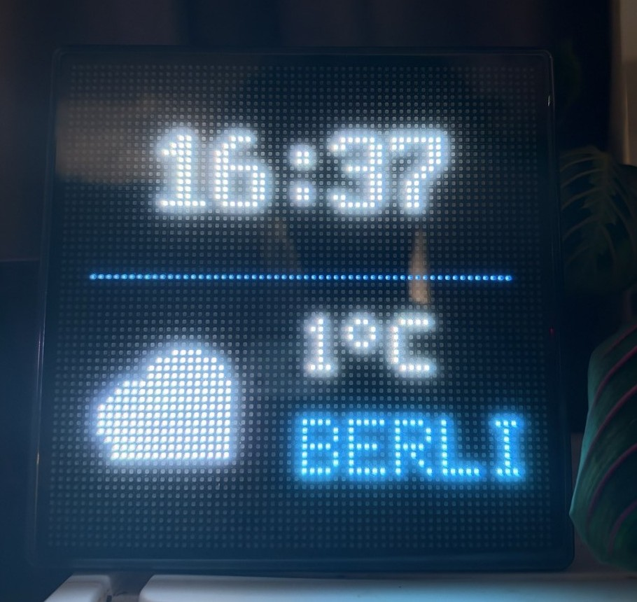
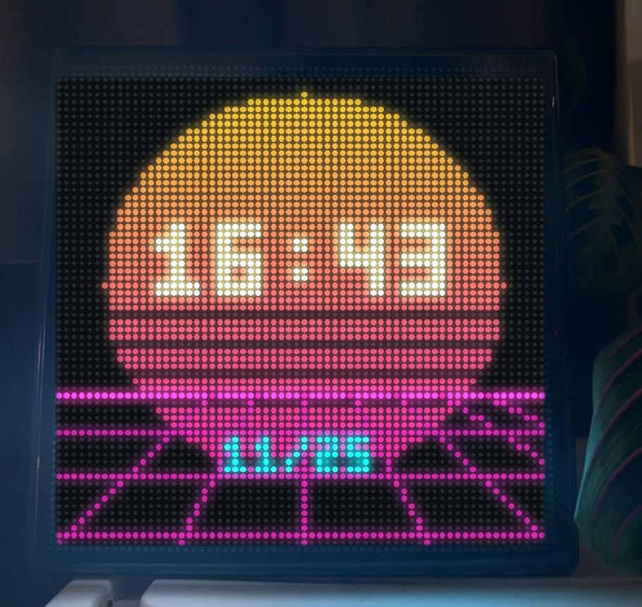
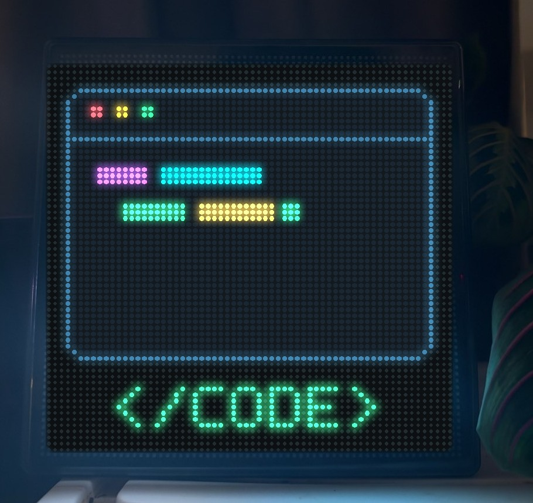
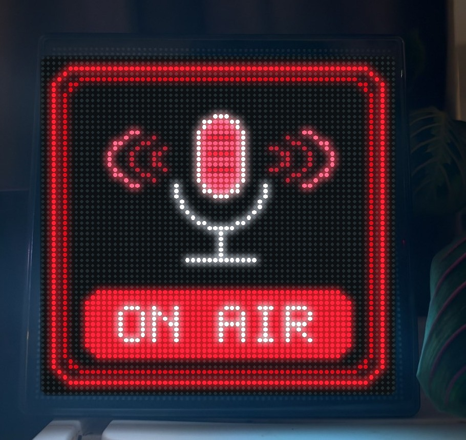
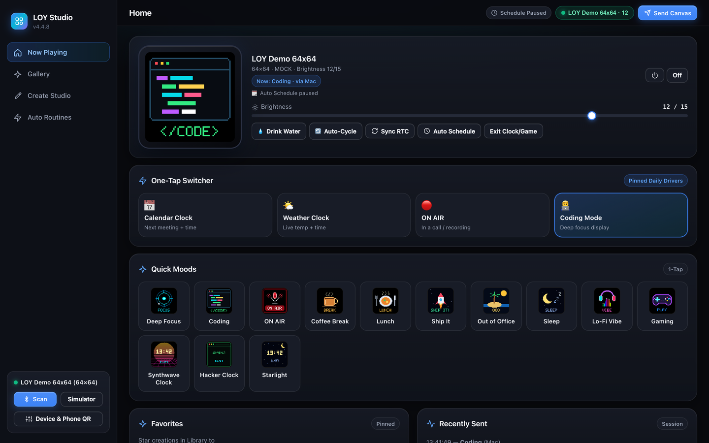
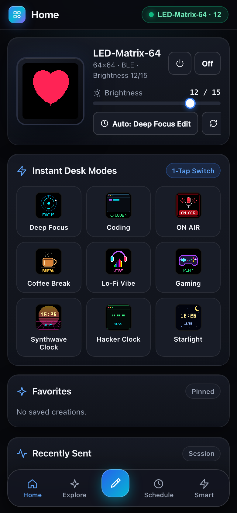

# LOY Studio — Offline `64×64` LED Pixel Display Controller & Creative Studio

A 100% local, privacy-first controller, creative pixel studio, and smart-desk automation suite for **`64×64` RGB LED Matrix Displays** over **Bluetooth Low Energy (BLE)**. Control your display from macOS or any phone on your local Wi-Fi — with zero cloud accounts, zero telemetry, and zero external dependencies.

---

## Live `64×64` Display Showcase

| Live Weather + RTC Clock | Synthwave Sun Hardware Clock |
| :---: | :---: |
|  |  |

| Coding Work Mode (`</CODE>`) | ON AIR Meeting Mode |
| :---: | :---: |
|  |  |

## App Screenshots

### Desktop Studio
| Home Dashboard & Instant Desk Modes | 15 Live Autonomous Hardware Clocks |
| :---: | :---: |
|  |  |

### Mobile PWA (iPhone / Android over Local Wi-Fi)
| Mobile Home & Floating Glass Dock | Touch & Multi-Touch Pixel Studio |
| :---: | :---: |
|  |  |

---

## Supported Display Hardware

- **Display Panel**: `64×64` RGB LED Pixel Matrix (`4,096` addressable LEDs, Bluetooth LE `YS*` / `EXYC-A` compatible panels)
- **On-Device Capabilities**:
  - Autonomous hardware **Real-Time Clock (RTC)** that keeps ticking offline
  - Static pixel artwork, multi-frame **animated GIFs**, and **layered clock + GIF** compositing (animated background behind clock or masked inside clock digits)
  - Built-in firmware clock faces, hardware brightness (`0–15`), orientation, screen power, arcade games, and room-audio mic visualizer

---

## Key Features & Upgrades

- **Mobile-First v3.0 OLED UI/UX**:
  - Floating 5-tab iOS-style glass dock on phones (`Home`, `Explore`, center `Create` FAB, `Schedule`, `Smart`) and full sidebar workspace on desktop.
  - Password-protected local Wi-Fi access (`--lan`) with QR code pairing — loopback (`127.0.0.1`) auto-trusted on Mac. Phone access stays **locked until you set a Wi-Fi password** (6+ characters) on the Mac; each phone gets its own session you can sign out from Device → Phone Access.
- **Multi-Touch & Fullscreen Drawing Studio**:
  - Responsive `64×64` LED simulator canvas with **Full Draw** edge-to-edge fullscreen mode and an inline quick color strip.
  - **Multi-touch support**: draw with multiple fingers simultaneously, **2-finger pinch-to-resize & pan** on floating text/emojis, and **Procreate-style 2-finger tap to Undo**.
  - **Movable Text & Animated Emojis**: drag & drop custom text or 20 emojis anywhere on the canvas, apply live motion effects (`Pulse`, `Bounce`, `Wiggle`, `Float`, `Spin`, `Sparkle`), or pick from 8 one-tap **Animated Emoji GIFs** + 6 editable **Pixel Art Templates**.
  - **Visual Animation Storyboard & 1-Tap Pixel Scenes**: 4-column visual frame grid with live **Speed + Brightness** sliders, 6 one-tap looping `64×64` scenes (**Synthwave Highway**, **Kaleidoscope**, **Plasma Rainbow**, **Cozy Campfire**, **Cyber Rain City**, **Pixel Aquarium**), an **Animated Neon Sign Builder** (`OPEN`, `CLOSED`, `NEW`, `LIVE`, custom text), onion skinning, mirror symmetry, GIF export, and **Photo / Video-to-LED** converter.
- **15 Autonomous Hardware RTC Clocks**:
  - Synthwave Sunset, Neon Ring, Sci-Fi HUD, Hacker Terminal, Retro Handheld, Starlight Night, Arcade Board, Heartbeat EKG, Gradient Pill, Flip Cards, Cyber Frame, Giant Stacked, HH:MM + Sec, Date + Time, and Minimal Big.
  - Combine any clock with an animated GIF **behind the clock** or **masked inside the digits**.
- **18 Built-In `64×64` Work Modes & Pixel Art GIFs**:
  - 10 Desk Work Modes (`Deep Focus`, `Coding`, `ON AIR`, `DND`, `Coffee Break`, `Pomodoro Flow`, `Gaming`, `Lo-Fi Vibe`, `BRB`, `Done/Night`) + 8 animated pixel visuals (Cyber Eyes, Matrix Rain, Retro Fire, Starfield, Rainbow Wave, Pac-Man, Equalizer).
- **Time & Day Auto-Mode Scheduler**:
  - 24-hour visual timeline, per-day (`M–S`) toggle pills, automatic brightness scheduling (e.g., night dimming), 1-click weekly presets, and per-rule live preview.
- **Google Home & Nest Hub Native Control (Local Matter Bridge)**:
  - Built-in 100% offline **Matter** bridge (`matter/bridge.mjs`) that pairs directly with Google Home / Google Nest Hub over local Wi-Fi — zero cloud accounts.
  - Exposes **`Desk Display`** (On/Off + `0–100%` Brightness slider) and voice-controllable scene switches (**`On Air Mode`**, **`Coding Mode`**, **`Synthwave Clock`**, **`Weather Clock`**) for *"Hey Google"* commands and Google Home Routines.
- **Smart Desk Automation & macOS Menu Bar**:
  - Zero-touch Mac context detection (auto `ON AIR` when Camera/Zoom is active, auto `Coding` in IDEs/Terminals, auto `BRB` when idle, Apple Calendar 5-minute meeting alerts).
  - Webhook alert flash (`POST /api/notify`) that displays a temporary alert and auto-restores the previous mode, plus optional keyless Open-Meteo Pixel Weather + RTC Clock and Hydration reminders.
  - Native macOS Menu Bar controller (`macos/menubar_app.py`) and `launchd` login auto-start (`macos/loy_ctl.sh`).

---

## Tech Stack & Framework

| Layer | Technology |
| :--- | :--- |
| **Backend Gateway** | Python 3.12, **aiohttp** (HTTP + WebSockets) |
| **Bluetooth LE Transport** | **Bleak** (macOS CoreBluetooth) with reliable ACK-paced streaming & auto-reconnect |
| **Graphics & Media Engine** | **Pillow (PIL)** for `64×64` rendering, clock compositing, quantization & GIF encoding; optional **FFmpeg** for video import |
| **Frontend UI / PWA** | Vanilla **HTML5 / CSS3 / JavaScript** (zero build step), Canvas 2D LED simulator, Service Worker PWA |
| **Portable Desktop App** | **Python (`pywebview` + PyInstaller)** self-contained `.app` (macOS) & `.exe` (Windows) |
| **Smart Home Bridge** | **Matter** (`@matter/main` + Node.js) for native local Google Home / Nest Hub control |
| **CI/CD Releases** | **GitHub Actions** automated testing & portable builds for macOS & Windows |
| **macOS Integration** | **rumps** Menu Bar app + `launchd` service (`macos/loy_ctl.sh`) |
| **Testing** | **pytest** protocol, server (MockTransport + aiohttp TestClient), auth & updater-signing suites |

---

## Project Structure

```text
.
├── app/                # Python BLE gateway, creative engine, smart desk automation & PWA UI
├── protocol/           # BLE framing, codecs, display commands & transport layer
├── gifs/               # 18 built-in 64×64 pixel-art & Work Mode animated GIFs
├── matter/             # Local Matter bridge for Google Home / Nest Hub voice & tile control
├── macos/              # macOS Menu Bar app, launchd plist template & loy_ctl.sh helper
├── desktop_app.py      # Portable desktop launcher (pywebview)
├── build_portable.py   # PyInstaller builder for macOS (.app) & Windows (.exe)
├── .github/workflows/  # Automated CI/CD Release Pipeline (macOS & Windows)
├── poc/                # Command-line controller (loy_cli.py)
├── tools/              # Pixel-art GIF generators & utility scripts
├── docs/screenshots/   # Desktop & mobile UI screenshots
└── tests/              # Automated pytest suite
```

---

## Quick Start

```bash
# 1. Create virtualenv & install dependencies
python3.12 -m venv .venv
source .venv/bin/activate
pip install -r requirements.txt

# 2. Run unit tests
pytest -q tests/

# 3. Start LOY Studio (localhost only, or add --lan for password-protected Wi-Fi phone access)
python app/server.py --lan --port 18420

# 4. Optional: start Google Home / Nest Hub local Matter bridge
cd matter && npm install && cd ..
./macos/loy_ctl.sh matter

# 5. Optional: launch macOS Menu Bar app or enable auto-start at login
./macos/loy_ctl.sh menubar
./macos/loy_ctl.sh install-login

# 6. Optional: trigger a temporary alert from any script
./macos/loy_ctl.sh notify "BUILD OK" "ALL PASS" success
```

---

## Security & Updates

- **Phone / LAN access** is refused until you set a Wi-Fi password on the Mac. Wrong passwords are rate-limited, and changing the password signs every phone out. Password, session and updater endpoints only work from the Mac itself.
- **Browser safety:** requests from other websites (cross-site / DNS-rebinding) are rejected, and the UI ships with a strict Content-Security-Policy.
- **In-app updates** are verified before install: every release publishes `SHA256SUMS`, and the app refuses a zip that does not match. To also require a signature, run `python tools/sign_release.py keygen`, put the secret in the `LOY_UPDATE_SIGNING_KEY` GitHub Actions secret, and paste the public key into `app/update_signing.py`.

## Display Program Slots

| Slot | Use |
| :--- | :--- |
| 1 ↔ 2 | Live double-buffer (upload hidden slot, then switch: no flicker) |
| 3 | Temporary alerts (RAM only) |
| 4 – 8 | On-device Flash schedule (up to 5 programs, runs with the Mac offline) |
| 9 | Throughput benchmark scratch (RAM only) |

If a switch shows a new image for a moment and then jumps back, the panel's program list is out of order: use **Device → Display & BLE Settings → Repair Display** on the Mac. It runs the panel's own Format Flash, which erases the stored images, then send something new.
